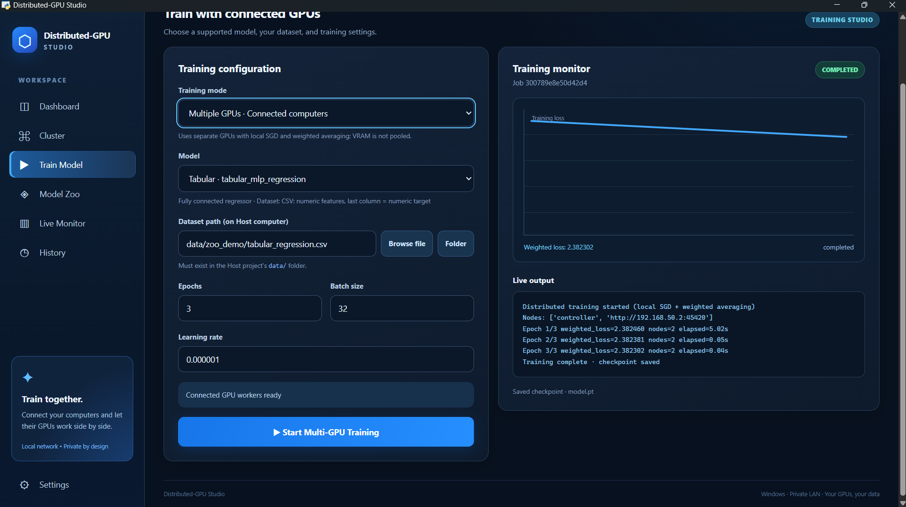

# Distributed-GPU Studio

**A Windows desktop workspace for training supported AI models across GPUs on multiple computers connected to a local network.**

[](#requirements)
[](#project-status)
[](#technology-stack)
[](#how-distributed-training-works)

> **Public beta — working on an already configured cluster.** Desktop UI, secure first-time pairing and a two-computer training smoke test have been demonstrated. A fully self-contained, fresh-PC Windows installer and reliable restart-to-reconnect behavior still need end-to-end validation. Please read [Current limitations](#current-limitations) before deploying.

## Overview

Distributed-GPU Studio connects existing NVIDIA CUDA GPUs over a trusted LAN so users can **create a cluster, approve another PC, choose a supported training preset, monitor progress and save a trained checkpoint** from a desktop interface.

It is intended to make multi-computer experimentation more approachable—not to act as a replacement for PyTorch DDP/FSDP, pool VRAM, or guarantee speedups for every workload.

### Desktop application — verified test



*Actual desktop beta test: GTX 1650 controller + RTX 2050 worker, tabular MLP regression, 3/3 epochs, 2 nodes, checkpoint saved. This is a functional test, **not** a performance benchmark.*

## Features

| Feature | Availability |
| --- | --- |
| Desktop dashboard, cluster management and training monitor | Working in tested beta |
| Pair a remote Windows PC using a short-lived code and device fingerprint | Demonstrated on two laptops |
| Detect local NVIDIA GPU and reachable remote workers | Implemented; check live state in app |
| Multi-computer training for supported models | **Demonstrated:** tabular MLP regression with 2 nodes |
| Local-only Model Zoo presets | Available when local backend/dependencies are installed |
| Model catalog with 15 presets | Catalog integrated; individual models not all end-to-end validated |
| Training logs, loss chart, checkpoints and job history | Demonstrated for distributed tabular regression |
| Windows desktop shortcut / one-click beta updater | Works on the configured test PC; fresh-PC support incomplete |
| Automatic cluster credential creation | Supported for a new host when no existing credential/controller is present |
| Automatic trusted-device reconnect after reboot | **Not yet verified / incomplete** |
| General-public installer with bundled CUDA/PyTorch service provisioning | **Not yet available** |

## Who should use it?

- Researchers, students and developers exploring distributed GPU training on **trusted Windows PCs**.
- Owners of two or more machines with compatible NVIDIA GPUs and an existing backend setup.
- Users experimenting with supervised learning, computer vision, text and time-series models supported by the installed Model Zoo.

This beta is **not ready for installation by arbitrary public users on a fresh PC**. No release should be called production-ready until clean-machine installation, secure network transport and reconnect tests pass.

## Quick start (already configured PCs)

The current desktop beta depends on the project's running Python/CUDA services. On the two-laptop test system, it was started with the included installer UI—without typing commands in the normal application workflow.

1. Get the latest tested desktop beta source/package from this repository (or an explicitly published **beta** asset under [Releases](https://github.com/Dsaini2002/Distributed-GPU/releases), if available).
2. Make sure the existing controller service and the worker's local pairing agent are installed and running. A plain ZIP does **not** install the full GPU backend from scratch.
3. Keep the `Desktop-App/` folder beside **`Install Distributed-GPU Studio.vbs`** in the extracted package; double-click the `.vbs` file and select **Install & Open App** on a computer with the existing project installed.
4. On the **host**, open **Cluster → Create Cluster**, generate a one-time join code.
5. On the **worker**, choose **Join Cluster**, enter the host's code, and verify the displayed fingerprint against the host before approving.
6. In **Train Model**, select **Multiple GPUs**, a supported model, a dataset available in the host project's `data/` directory, and training settings. Start the job and observe its logs and checkpoint status.

**First-time pairing** needs owner approval. Do not share private cluster tokens. Codes are short-lived; an approved session is not proof that reconnect-after-reboot is reliable.

For the build/source workflow, see [Developer and Windows build instructions](#developer-and-windows-build-instructions).

## Model Zoo

The installed Model Zoo includes the following **15 architecture presets**. Availability depends on the chosen execution mode, correctly structured data, installed dependencies and GPU capacity.

| Category | Available presets | Typical dataset |
| --- | --- | --- |
| Tabular | `tabular_mlp_regression`, `tabular_mlp_classification` | Numeric CSV, target in final column |
| Image classification | `image_cnn`, `resnet18`, `mobilenet_v3_small`, `efficientnet_b0`, `tiny_vit` | Class-labeled image folders |
| Image segmentation | `unet_segmentation` | Matching `images/` and `masks/` files |
| Audio | `audio_spectrogram_cnn` | Spectrogram image folders (not raw WAV) |
| Text | `text_gru`, `text_transformer` | CSV containing text and labels |
| Small language model | `tiny_transformer_lm` | UTF-8 `.txt` corpus |
| Time series | `time_series_lstm` | Numeric CSV time series |
| Experimental, additional dependencies | `distilgpt2_lora`, `yolo11n_detection` | Text corpus / YOLO dataset YAML |

**Execution modes:** The first 13 presets are included in the installed local model catalog and eligible for the current distributed trainer's supported list, but **individual training success across multiple GPUs is not yet verified for all of them**. The two experimental presets are **local-only in the current backend** and may require additional downloads, packages or more memory. An entry in the catalog does not mean the model is guaranteed to run on a 4 GB GPU.

## How distributed training works

```text
                  HOST COMPUTER                         WORKER COMPUTER
              ┌───────────────────┐                   ┌───────────────────┐
              │ Desktop Studio UI │                   │ Join Agent        │
              │ Controller API    │──── LAN pairing ──│ Background Worker │
              │ Local CUDA GPU    │                   │ Remote CUDA GPU   │
              └─────────┬─────────┘                   └─────────┬─────────┘
                        │          data shards                 │
                        └──────────────┬───────────────────────┘
                                       ▼
                          Train local model copies
                                       │
                                       ▼
                           Weighted parameter merge
                                       │
                                       ▼
                            Checkpoint + live status
```

1. The dataset is partitioned into per-node shards.
2. Each GPU trains a **separate copy of the model** for an epoch using local SGD-style updates.
3. Model parameters are combined using **sample-count-weighted averaging**.
4. The merged model is saved as a checkpoint after the training job finishes.

**Important:** GPU VRAM is **not combined** (two 4 GB GPUs are not a single 8 GB GPU). This is not gradient all-reduce DDP, tensor parallelism, FSDP, or a full-size LLM training solution. Model weights must still fit on the individual GPU.

## Verified test run

The desktop training screenshot records:

| Measurement | Observed result |
| --- | --- |
| Controller | NVIDIA GeForce GTX 1650 |
| Worker | NVIDIA GeForce RTX 2050 |
| Nodes | 2 |
| Model | `tabular_mlp_regression` |
| Training algorithm | Local SGD + sample-weighted parameter averaging |
| Samples | 48 (as reported by the earlier backend smoke test) |
| Epochs | 3 / 3 |
| Final weighted training loss | **2.382302** in the desktop test shown |
| Checkpoint | `model.pt` saved by the controller |

The extremely small learning rate used in the pictured test (`0.000001`) led to a small improvement in loss. The screenshot documents that the workflow completed, **not** that the system is faster or produces a better final model than single-GPU training.

## Requirements

**For the current beta:**

- Windows 10 or 11 on the involved computers (Windows 11 was used in the documented test setup).
- A supported NVIDIA GPU, working driver and compatible PyTorch CUDA environment **on each training node**.
- A trusted LAN or direct Ethernet connection between host and worker.
- An existing installed backend: controller, Model Zoo, multi-computer trainer and pairing agent.
- Sufficient local storage and VRAM for the selected model/dataset.
- Windows WebView2 Runtime and the desktop shell's dependencies for the test updater; see `Desktop-App/` for the developer build requirements.

The current default API ports in the test environment are **45400 (controller), 45420 (training worker), and 45430 (worker-local join UI)**. Hostnames and LAN IP addresses may differ across installations. Do **not** port-forward these prototype services to the internet.

## Repository structure

```text
Distributed-GPU/
├── Desktop-App/              # Windows desktop shell, assets and build scripts
├── studio/                   # Controller and existing app endpoints
├── studio_zoo/               # Model catalog and local trainers
├── studio_multi/             # Multi-node training coordinator and worker
├── studio_pairing/           # Device pairing and local join agent
├── docs/
│   ├── images/               # Screenshots used by this README
│   └── PUBLISH_GUIDE.md      # Safe GitHub push and release steps
├── README.md
├── SECURITY.md
└── .gitignore
```

*Some auxiliary folders and setup scripts vary between development snapshots; this tree highlights core components.*

## Developer and Windows build instructions

> The commands in this section are for **contributors and maintainers**, not normal end users.

The desktop shell lives in `Desktop-App/` and is built with Python and pywebview. The build requires Windows; compiling the EXE does not install the training backend.

```powershell
cd Desktop-App
python -m pip install -r requirements-desktop.txt
.\Build-Windows.ps1 -Python (Get-Command python).Source
```

A successful portable build is expected at:

```text
Desktop-App/dist/DistributedGPUStudio/DistributedGPUStudio.exe
```

To build a setup wizard, install Inno Setup 6 with its `ISCC.exe` available on PATH, then run:

```powershell
.\Build-Windows.ps1 -Python (Get-Command python).Source -Installer
```

A successful installer build is expected under `Desktop-App/installer-output/`. **These Windows build outputs have not been independently validated here; test on a clean machine before publishing them.**

For the full maintainer checklist (including source staging and release verification), read [`docs/PUBLISH_GUIDE.md`](docs/PUBLISH_GUIDE.md).

## Technology stack

| Layer | Technology |
| --- | --- |
| Desktop | pywebview, WebView2, HTML, CSS, JavaScript |
| Service/API | Python, FastAPI, Uvicorn |
| Training | PyTorch + CUDA |
| Pairing | Short-lived join codes, RSA-OAEP transport of a cluster credential, Windows DPAPI at rest |
| Multi-node communication | HTTP over a trusted local network |
| Packaging | PyInstaller, Inno Setup (optional) |

## Current limitations

- **Public beta, not a turnkey installation:** a complete fresh-Windows-PC backend installer is still in progress.
- **Security:** legacy clusters may use short tokens; securely rotating shared credentials across machines, TLS and per-device revocation are outstanding. Use only on isolated, trusted local networks.
- **Persistence:** approved devices are currently tracked in the controller process; restart/reboot reconnection has not been reliably verified.
- **Model support:** the Model Zoo contains presets, not universal training of arbitrary AI models. Full-size LLMs and SDXL multi-GPU training are not verified or advertised as supported.
- **Hardware:** each GPU needs enough VRAM to hold its own model copy; memory is not pooled.
- **Performance:** network overhead may negate speedups for small workloads; no standardized benchmark is published yet.
- **UI:** additional validation, accessibility and clean-install testing remain necessary.

## Roadmap

- [x] Working Windows desktop shell on the configured test PC
- [x] Create → Join → fingerprint approval on the test cluster
- [x] Complete a real two-node distributed training run and save a checkpoint
- [x] Integrate local and distributed model catalog APIs into the desktop shell
- [ ] Test all supported model presets with representative datasets
- [ ] Improve input validation and user-friendly error recovery
- [ ] Persist trust and restore paired workers automatically after reboot
- [ ] Complete secure key rotation, TLS and device revocation
- [ ] Package backend dependencies and provide a clean-PC Windows setup experience
- [ ] Sign, scan and publish validated Windows release installers

## Troubleshooting

| Problem | What to check |
| --- | --- |
| `401: Login required` in Model Zoo | Use the latest desktop source and ensure the desktop bridge can read the existing Windows-protected credential on the host account. Do not disable controller authentication globally. |
| Host cannot find worker | Verify both machines are on the same trusted LAN, that the join agent and GPU worker are online, and that the required port is reachable. |
| No approval request appears | Regenerate an unexpired code, confirm worker points to the correct host, and check the fingerprint before approval. |
| A model refuses to train | Check model-specific data format, CUDA availability, VRAM, optional dependencies and training logs. |
| Windows installer launches but backend is unavailable | The desktop beta does not provision the controller/worker services on a fresh PC. |
| Missing saved model | Look under `.dgpu/phase19_runs/<job-id>/` or the job-specific path shown by the monitor. These folders are intentionally ignored by Git. |

## Security and privacy

Secrets, session cookies, tokens, generated model weights, user datasets, training histories and local virtual environments must **never be pushed to the public repository**. The included `.gitignore` excludes common local paths, but **ignore rules do not untrack files already committed**. Review staged changes carefully. See [`SECURITY.md`](SECURITY.md).

## Contributing

Issues and reproducible bug reports are welcome. Please include Windows version, GPU model, the operation attempted, a redacted error/log excerpt and steps to reproduce. **Never include cluster tokens, private IPs tied to sensitive networks, datasets containing personal information or private checkpoints.**

## License

**License not yet selected.** Source availability on GitHub does not automatically grant open-source reuse rights. Add a `LICENSE` file only after choosing and reviewing the license appropriate for this project.

---

**Distributed-GPU Studio** · Train supported models across connected computers, without pretending VRAM is pooled.
